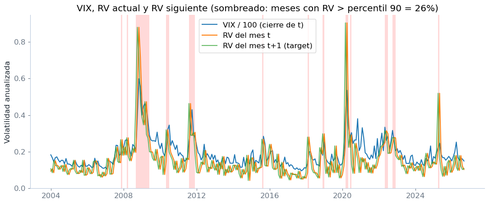
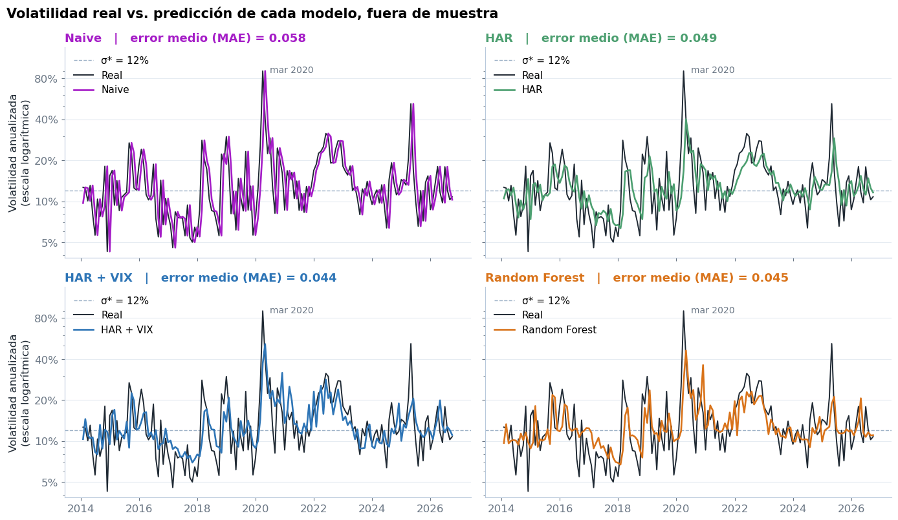
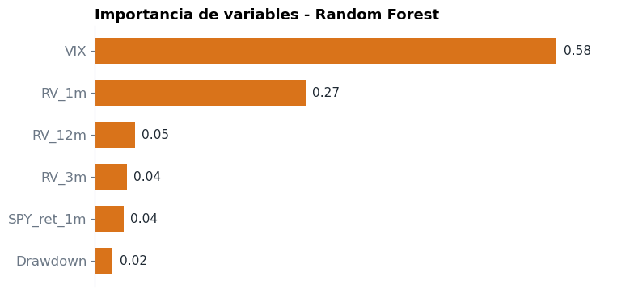
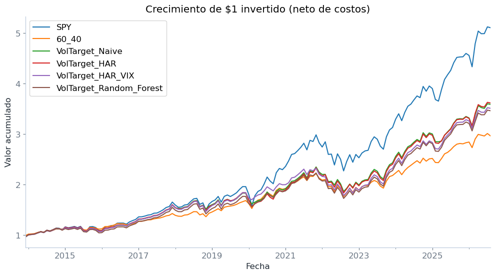
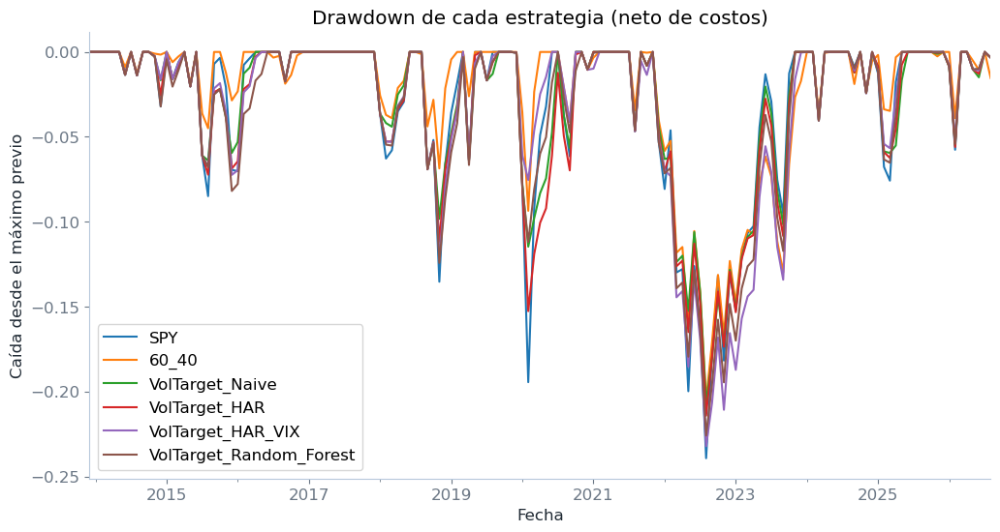
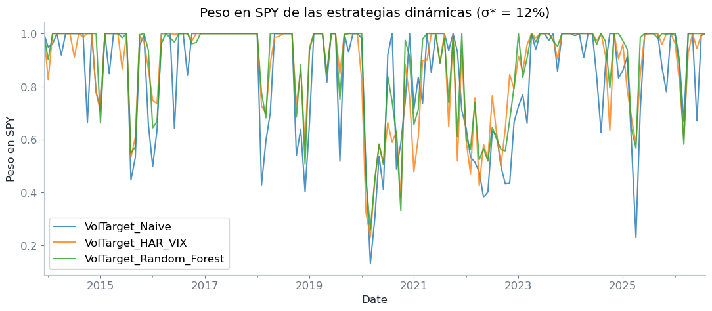

# Predicción de la volatilidad del S&P 500 y asignación dinámica entre acciones y bonos

Trabajo de Finanzas Cuantitativas que estudia si un modelo de Machine Learning (Random Forest) predice la volatilidad mensual futura del S&P 500 mejor que benchmarks simples, y si esa mejor predicción se traduce en una cartera SPY/IEF con mejor relación riesgo-retorno mediante *volatility targeting*.

La idea central no es adivinar si el mercado sube o baja, sino estimar **cuán variable** será el mes siguiente y usar esa estimación para decidir cuánto invertir en acciones.

- **Materia:** Finanzas Cuantitativas — Facultad de Ciencias Exactas y Naturales (FCEN), Universidad de Buenos Aires (UBA)
- **Año / período:** octubre de 2026
- **Autoras:** Nicole Lamblot, Camila Lamblot y Julieta Valdez

## Tecnologías

Python 3.12 · pandas · NumPy · scikit-learn (`LinearRegression`, `RandomForestRegressor`) · yfinance · matplotlib · Jupyter Notebook

## Qué hace el proyecto

1. **Descarga de datos.** Precios diarios de SPY (acciones), IEF (bonos) y del índice VIX desde Yahoo Finance (desde 2003-01-01), y la tasa libre de riesgo a 3 meses (DTB3) desde FRED.
2. **Limpieza y control de calidad.** Tratamiento de faltantes (feriados) y descarte del último mes si está incompleto, para no calcular volatilidad con pocos días.
3. **Construcción de variables mensuales.** Volatilidad realizada (RV) del mes: desvío estándar de los retornos logarítmicos diarios × √252. Se calculan RV de 1, 3 y 12 meses (promedios móviles), VIX a fin de mes, retorno mensual de SPY y drawdown de SPY.
4. **Target.** Logaritmo de la RV del mes *siguiente* (t+1), usando solo información disponible al cierre del mes t. El notebook incluye un chequeo explícito de que no hay información futura.
5. **Modelos comparados** (validación *walk-forward* con ventana expansiva):

   | Modelo | Variables |
   |---|---|
   | Naive | repite la RV del mes anterior (benchmark mínimo) |
   | HAR | regresión lineal sobre log RV de 1, 3 y 12 meses |
   | HAR + VIX | HAR más el log del VIX |
   | Random Forest | las 6 variables (RV 1m/3m/12m, VIX, retorno de SPY, drawdown) |

6. **Evaluación predictiva fuera de muestra:** MAE, RMSE y R², error por año y métricas excluyendo 2020.
7. **Regla de cartera y backtest.** Con la volatilidad prevista σ̂ₜ₊₁, el peso en SPY es `min(1, σ* / σ̂ₜ₊₁)` y el resto va a IEF (sin apalancamiento). Se compara contra SPY solo y una cartera fija 60/40.
8. **Robustez.** Sensibilidad a la volatilidad objetivo σ* (10%, 12%, 15%) y a los costos de transacción (0%, 0,10%, 0,25%).

## Decisiones importantes de modelado

- **Se predice el log de la RV**, porque la RV tiene una cola derecha larga (asimetría 3,62 contra 0,76 para log RV).
- **Validación walk-forward**: se entrena con los primeros 120 meses (10 años), se predice el mes siguiente, se agrega al entrenamiento y se repite. Resultan 153 predicciones fuera de muestra; nunca se mezcla pasado con futuro.
- **Hiperparámetros del Random Forest fijados a priori** (300 árboles, profundidad máxima 5, `min_samples_leaf=5`, semilla 42), sin optimizar contra el período de test.
- **Se agrega un HAR + VIX** como benchmark lineal con la misma información clave que el Random Forest, para separar el efecto de "usar el VIX" del efecto de "usar un modelo no lineal".
- **Las decisiones se toman en t y se aplican a los retornos de t+1.** Costo de transacción de 0,10% por unidad de turnover (caso base); métricas netas de costos.
- **Sharpe** calculado sobre retornos en exceso de la tasa DTB3 (conocida al cierre de t, aplicada al mes t+1).

## Resultados principales

Período de test: 153 meses (retornos de enero 2014 a septiembre 2026). Datos de los outputs del notebook.

**Predicción de la volatilidad (fuera de muestra)**

| Modelo | MAE | RMSE | R² |
|---|---|---|---|
| Naive | 0,058 | 0,098 | −0,08 |
| HAR | 0,049 | 0,086 | 0,17 |
| **HAR + VIX** | **0,044** | **0,073** | **0,40** |
| Random Forest | 0,045 | 0,079 | 0,30 |

**Cartera (σ* = 12%, costo 0,10%, neto de costos)**

| Estrategia | Retorno anual | Sharpe | Máx. drawdown |
|---|---|---|---|
| SPY | 13,65% | 0,828 | −23,9% |
| VolTarget Naive | 10,55% | 0,799 | −20,7% |
| VolTarget HAR + VIX | 10,36% | 0,779 | −23,2% |
| 60/40 | 8,90% | 0,760 | −20,5% |
| VolTarget HAR | 10,61% | 0,760 | −21,4% |
| VolTarget Random Forest | 10,24% | 0,750 | −22,6% |

### Conclusiones

1. **Predicción:** los tres modelos con variables explicativas reducen el error respecto del Naive. El mejor es HAR + VIX, seguido de cerca por el Random Forest. La mejora proviene de incorporar el VIX (en el Random Forest concentra ~58% de la importancia de variables, calculada con toda la muestra, solo descriptiva), no de la no linealidad: un modelo lineal con VIX iguala o supera al Random Forest.
2. **Cartera:** ninguna estrategia de volatility targeting superó a SPY en Sharpe neto, con σ* de 10%, 12% y 15%. El targeting redujo el drawdown máximo en algunos casos (p. ej. −20,7% con Naive contra −23,9% de SPY) a costa de unos 3 puntos de retorno anual.
3. **Mejor predicción ≠ mejor decisión:** el ranking por error se invierte en la cartera. El Naive, el que peor predice, es la mejor estrategia dinámica en los 9 escenarios de robustez. Una posible explicación (hipótesis del trabajo, no testeada): con el tope de 100% en SPY, muchas predicciones distintas llevan a la misma decisión, y cuando la volatilidad prevista supera σ*, reaccionar rápido pesa más que acertar el nivel.
4. **Limitaciones** (declaradas en el trabajo): el test es mayormente alcista y no incluye la crisis de 2008; las diferencias de Sharpe son chicas y no se testearon estadísticamente; costos y tasa libre de riesgo son aproximados.

### Figuras

| | |
|---|---|
|  |  |
| VIX, RV del mes y RV del mes siguiente (sombreado: 10% de meses con RV más alta) | Volatilidad real vs. predicción de cada modelo, fuera de muestra |
|  |  |
| Importancia de variables del Random Forest (modelo ajustado con toda la muestra) | Crecimiento de $1 invertido, neto de costos |
|  |  |
| Drawdown de cada estrategia | Peso en SPY de las estrategias dinámicas (σ* = 12%) |

El póster del trabajo está en [`docs/poster_volatility_targeting_ml.pdf`](docs/poster_volatility_targeting_ml.pdf).

## Cómo ejecutarlo

1. Clonar o descargar el repositorio y, desde su carpeta, instalar las dependencias:

   ```bash
   pip install -r requirements.txt
   ```

2. Abrir y ejecutar el notebook de arriba hacia abajo (*Run All*):

   ```bash
   jupyter notebook prediccion_volatilidad_sp500.ipynb
   ```

El notebook no lee archivos locales: descarga los datos directamente de Yahoo Finance (vía `yfinance`) y de FRED, por lo que **requiere conexión a internet**. No genera archivos de salida.

**Tiempo aproximado:** unos 1 a 3 minutos, dominado por los 153 reentrenamientos del Random Forest (estimación: en una prueba con datos sintéticos del mismo tamaño tardó ~70 segundos en 2 núcleos; el notebook no registra tiempos) más la descarga.

**Cosas a tener en cuenta:**

- Los datos se descargan al momento de ejecutar, así que si se corre en otra fecha (o Yahoo ajusta series históricas) los números pueden diferir levemente de los reportados. Los resultados de este README corresponden a la corrida guardada en el notebook (datos hasta septiembre de 2026).
- El notebook descarta el último mes si está incompleto. Como indica un comentario del propio código, si el último día hábil del mes es feriado en EE.UU., este control puede descartar un mes que en realidad está completo.
- Se desarrolló con Python 3.12; `resample("ME")` requiere pandas ≥ 2.2. `jinja2` se incluye porque pandas lo necesita para las tablas con estilo (`.style`).

## Estructura del repositorio

```
volatility-targeting-sp500-ml/
├── prediccion_volatilidad_sp500.ipynb   # análisis completo (con outputs guardados)
├── requirements.txt
├── .gitignore
├── README.md
├── docs/
│   └── poster_volatility_targeting_ml.pdf
└── images/
    ├── 01_vix_rv_alta_volatilidad.png
    ├── 02_volatilidad_real_vs_prediccion.png
    ├── 03_importancia_variables_rf.png
    ├── 04_crecimiento_1_dolar.png
    ├── 05_drawdowns.png
    └── 06_peso_spy_estrategias_dinamicas.png
```

## Fuentes de datos

- **Yahoo Finance** (vía `yfinance`, precios ajustados): SPY, IEF e índice VIX (`^VIX`), frecuencia diaria desde 2003-01-01.
- **FRED**: serie [DTB3](https://fred.stlouisfed.org/series/DTB3) (tasa a 3 meses), usada como tasa libre de riesgo.

Los datos no se incluyen en el repositorio; se descargan al ejecutar el notebook.

## Autores

- Nicole Lamblot
- Camila Lamblot
- Julieta Valdez

*Trabajo realizado para la materia Finanzas Cuantitativas (FCEN-UBA), 2026.*
